# HƯỚNG DẪN SỬ DỤNG HIMOTO

**Dành cho:** nhân viên cơ sở, PKD, quản lý, kế toán và Admin.
**Cập nhật:** 06/11/2026.
**Phạm vi:** giao diện web; tên nút và tính năng hiển thị tùy quyền của tài khoản.

Ảnh trong tài liệu được chụp từ biểu mẫu trống trên giao diện thực tế. Các ví dụ số tiền bên dưới chỉ dùng để giải thích thao tác.

## Mục lục

1. [Đăng nhập và chọn cơ sở](#1-đăng-nhập-và-chọn-cơ-sở)
2. [Tìm hợp đồng](#2-tìm-hợp-đồng)
3. [Tạo hợp đồng mới — từng bước có ảnh](#3-tạo-hợp-đồng-mới--từng-bước-có-ảnh)
4. [Lưu và mở lại bản nháp](#4-lưu-và-mở-lại-bản-nháp)
5. [Duyệt hợp đồng](#5-duyệt-hợp-đồng)
6. [Nhận cọc giữ xe](#6-nhận-cọc-giữ-xe)
7. [Gia hạn và thu tiền](#7-gia-hạn-và-thu-tiền)
8. [Trả xe, đặc biệt hợp đồng nhiều xe](#8-trả-xe-đặc-biệt-hợp-đồng-nhiều-xe)
9. [Sửa hợp đồng và gửi lại Telegram](#9-sửa-hợp-đồng-và-gửi-lại-telegram)
10. [Đọc báo cáo doanh số](#10-đọc-báo-cáo-doanh-số)
11. [Xóa, ẩn hợp đồng và phân quyền](#11-xóa-ẩn-hợp-đồng-và-phân-quyền)
12. [Các thao tác quản lý khác](#12-các-thao-tác-quản-lý-khác)
13. [Xử lý tình huống thường gặp](#13-xử-lý-tình-huống-thường-gặp)
14. [Danh sách kiểm tra cuối giao dịch](#14-danh-sách-kiểm-tra-cuối-giao-dịch)

15. [Phân ca và mã ca chấm công](#15-phan-ca-va-ma-ca-cham-cong)
16. [Chấm công vào và ra ca](#16-cham-cong-vao-va-ra-ca)
17. [Xử lý Telegram chậm hoặc gửi chưa đủ](#17-xu-ly-telegram-cham-hoac-gui-chua-du)

## 1. Đăng nhập và chọn cơ sở

1. Mở địa chỉ HIMOTO do quản trị cung cấp.
2. Đăng nhập bằng tài khoản cá nhân được cấp.
3. Kiểm tra ô **Cơ sở đang xem** ở đầu trang.
4. Chọn cơ sở cần làm việc; chọn **Tất cả cơ sở** nếu tài khoản có phạm vi phù hợp.
5. Chọn chức năng ở menu bên trái. Trên màn hình nhỏ, mở menu điều hướng trước.

**Cần nhớ:** cơ sở đang xem là bộ lọc. Trong biểu mẫu hợp đồng, cơ sở có xe và cơ sở ghi nhận nguồn khách/doanh thu là hai lựa chọn riêng. PKD và các tài khoản trụ sở có phạm vi toàn hệ thống được chọn theo quyền đã cấp.

## 2. Tìm hợp đồng

1. Mở **Danh sách hợp đồng**.
2. Nhập mã hợp đồng, tên khách hoặc biển số vào ô tìm kiếm.
3. Chọn tab trạng thái phù hợp: **Đang thuê**, **Quá hạn**, **Nháp**, **Đặt cọc**, **Hoàn thành**…
4. Mở **Bộ lọc nâng cao** nếu cần lọc loại hợp đồng, nguồn khách hoặc ngày bắt đầu thuê.
5. Tại dòng cần xử lý, mở nút **Thao tác** hoặc dấu ba chấm.
6. Kiểm tra mã hợp đồng, khách và biển số trước khi chọn nghiệp vụ.

Không tìm thấy hợp đồng: thử bỏ bộ lọc trạng thái, ngày và cơ sở trước khi tìm lại.

## 3. Tạo hợp đồng mới — từng bước có ảnh

**Chuẩn bị:** thông tin khách, căn cước, giấy phép lái xe nếu có, xe bàn giao, thời gian thuê, tiền cọc, tiền thuê, phí phát sinh và chứng từ thu tiền.

Vào **Danh sách hợp đồng → Nhập hợp đồng**. Biểu mẫu có năm phần; dùng các tab hoặc nút **Tiếp tục / Quay lại** để di chuyển.

### Bước 1 — Hợp đồng và nguồn khách

1. Chọn **Loại hợp đồng**.
2. Nhập **Mã hợp đồng / Số HĐ giấy** đúng trên giấy; giữ nguyên số 0 ở đầu. Nếu để trống, hệ thống cấp số khi hoàn tất.
3. Kiểm tra **Ngày ký hợp đồng** và **Ngày tạo / nhập hợp đồng**.
4. Chọn **Liên kết nguồn khách**: cơ sở ghi nhận nguồn khách/doanh thu.
5. Điền **Nguồn khách**: có gợi ý **Cửa hàng**, **TLS**, **PKD1**, **PKD2**, hoặc chọn nhân sự phù hợp.
6. Kiểm tra **NVKD / TPKD / TLS ghi nhận doanh số**. Nguồn khách và nhân viên được ghi nhận là hai thông tin cần đối chiếu riêng.

**Kết quả cần thấy:** đúng loại hợp đồng, đúng số HĐ giấy, đúng cơ sở nguồn và nhân viên được phân công.

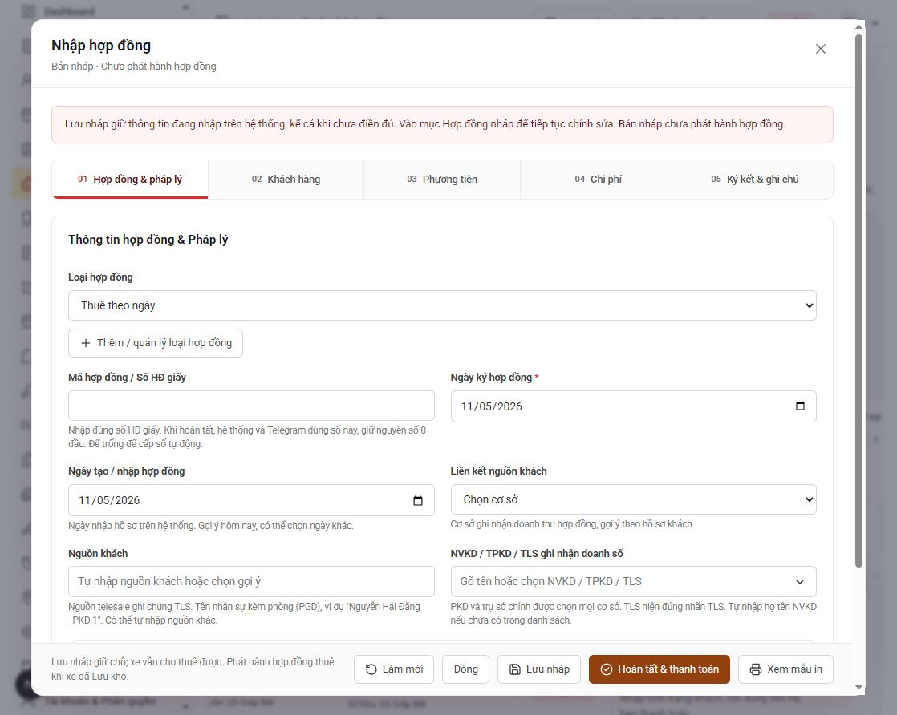

### Bước 2 — Tra cứu khách hàng

1. Chọn **Cửa hàng xe**: nơi có xe sẽ bàn giao.
2. Điền **Người làm hợp đồng / đại diện Bên A**.
3. Nhập CCCD, hộ chiếu, số điện thoại hoặc thông tin liên hệ vào ô **Tra cứu**.
4. Bấm **Tra cứu** và chọn đúng hồ sơ nếu có nhiều kết quả.
5. Đối chiếu tên, số giấy tờ, số điện thoại và cảnh báo của khách.
6. Nếu chưa có khách, bấm **Thêm mới** sau khi đã chọn cơ sở.

Các ô hồ sơ có thể bị khóa khi chưa tra cứu hoặc chưa tạo khách. Đây là bước chọn hồ sơ, không phải lỗi bàn phím.

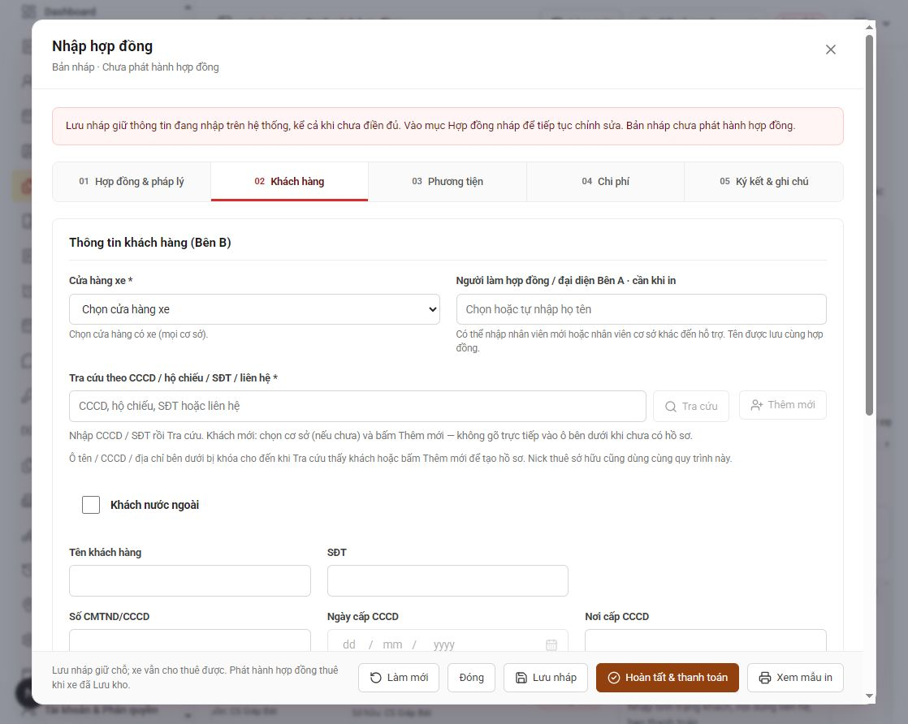

### Bước 3 — Khách mới và quét QR căn cước

1. Trong cửa sổ **Thêm khách hàng tại chỗ**, chọn **Chọn ảnh · Quét QR căn cước**, hoặc **Chụp ảnh / Chọn ảnh** tại phần căn cước.
2. Chụp rõ phần mã QR, đủ sáng, không bị cắt góc hoặc lóa.
3. Chờ hệ thống giải mã QR để điền số căn cước, họ tên và ngày cấp khi QR có dữ liệu hợp lệ.
4. Kiểm tra lại thông tin vừa điền. Bổ sung số điện thoại, nơi cấp, địa chỉ đang ở và các trường còn thiếu.
5. Thêm thông tin GPLX và người thân theo hồ sơ thực tế.
6. Kiểm tra **Cơ sở nguồn khách** và **Trạng thái hồ sơ**.
7. Bấm **Lưu khách hàng**; sau đó tiếp tục hợp đồng.

**Lưu ý:** QR căn cước không cung cấp số điện thoại hoặc nơi cấp. Địa chỉ đang ở phải được nhập/kiểm tra riêng. Nếu không đọc được QR, chụp lại rõ hơn hoặc nhập tay. Với khách nước ngoài, bật **Khách nước ngoài** và dùng hồ sơ hộ chiếu phù hợp.

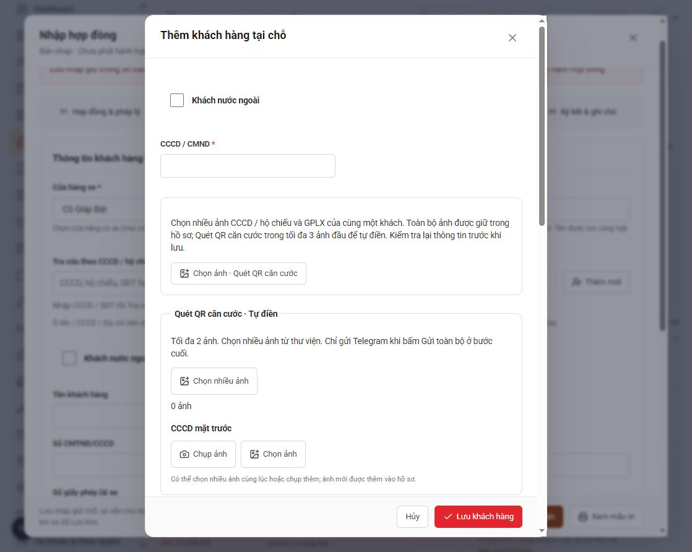

### Bước 4 — Thời gian thuê và phương tiện

1. Chọn tab **Phương tiện**.
2. Nhập ngày, giờ **Thuê lúc** và **Hẹn trả**. Giờ sử dụng định dạng 24 giờ, ví dụ 15:30.
3. Có thể nhập **Số ngày thuê** để gợi ý ngày trả; kiểm tra lại mốc cuối cùng.
4. Chọn cửa hàng có xe, rồi chọn xe theo đúng biển số.
5. Điền thông tin người lái, GPLX và phụ kiện giao kèm khi cần.
6. Nếu một hợp đồng thuê nhiều xe, bấm **Thêm xe** và kiểm tra từng biển số.
7. Chụp ảnh toàn cảnh, các góc xe, đồng hồ/phụ kiện và video theo hồ sơ bàn giao.

**Kết quả cần thấy:** đủ các xe thực tế bàn giao, đúng thời gian và ảnh/video đúng xe. Xe đang được hợp đồng khác sử dụng cần được kiểm tra tình trạng trước khi phát hành.

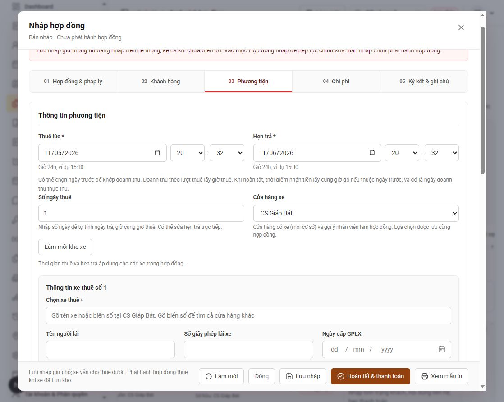

### Bước 5 — Tiền cọc, tiền thuê và phí khác

1. Chọn tab **Chi phí**.
2. Nhập **Số tiền đặt cọc** và hình thức dự kiến nhận cọc.
3. Chọn **Gói thuê**, kiểm tra **Đơn giá áp dụng** và **Tiền thuê xe**.
4. Thêm VAT, bảo hiểm hoặc khoản khác bằng **Thêm khoản phí**, ghi rõ tên và số tiền từng khoản.
5. Kiểm tra **Tổng tiền thuê và phí khác** và **Tổng cần thu gồm cọc**.
6. Chọn hình thức dự kiến thu thuê/phí và bổ sung chứng từ nếu có.

**Phân biệt số tiền:**

| Khoản | Ý nghĩa |
| --- | --- |
| Tiền cọc | Theo dõi riêng với tiền thuê |
| Tiền thuê xe | Phần tính doanh số thuê xe theo quy tắc của hệ thống |
| VAT, sửa xe, trả muộn, phí khác | Ghi riêng cho Công ty; không cộng vào doanh số nhân viên/cơ sở |
| Tổng cần thu | Số khách phải trả; chưa đồng nghĩa đã nhận đủ tiền |

Ví dụ: thuê 500.000 đồng + VAT 50.000 đồng + cọc 2.000.000 đồng → tổng cần thu 2.550.000 đồng. Phần doanh số thuê xe là 500.000 đồng; VAT ghi riêng cho Công ty.

**Đơn giá nhiều xe:** đọc gợi ý ngay dưới ô đơn giá. Ở gói thuê đang minh họa, đơn giá áp dụng cho toàn bộ xe trong hợp đồng mỗi ngày; không tự nhân thêm số xe lần nữa.

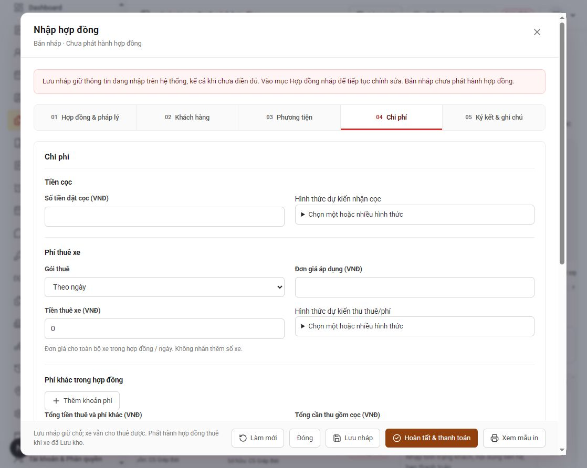

### Bước 6 — Ký kết, lưu nháp hoặc hoàn tất

1. Chọn tab **Ký kết & ghi chú**.
2. Ghi tài sản thế chấp và ghi chú cần thiết.
3. Kiểm tra người ký Bên A, Bên B.
4. Chụp/tải ảnh bộ hợp đồng đã ký và bill chuyển khoản.
5. Chọn **Xem mẫu in** nếu cần kiểm tra bản in.
6. Nếu chưa đủ thông tin, bấm **Lưu nháp**.
7. Nếu đủ điều kiện phát hành, bấm **Hoàn tất & thanh toán** và làm theo bước xác nhận: số tiền thực nhận, thời điểm nhận, hình thức, tài khoản/két nhận tiền.
8. Chỉ xác nhận khoản thực tế đã nhận. Kiểm tra kết quả lưu và trạng thái hợp đồng.
9. Tiếp tục bước Telegram để kiểm tra nội dung, ảnh/video rồi chủ động gửi.

**Lưu ảnh không đồng nghĩa đã gửi Telegram.** Cần bấm nút gửi ở bước cuối và chờ trạng thái xác nhận.

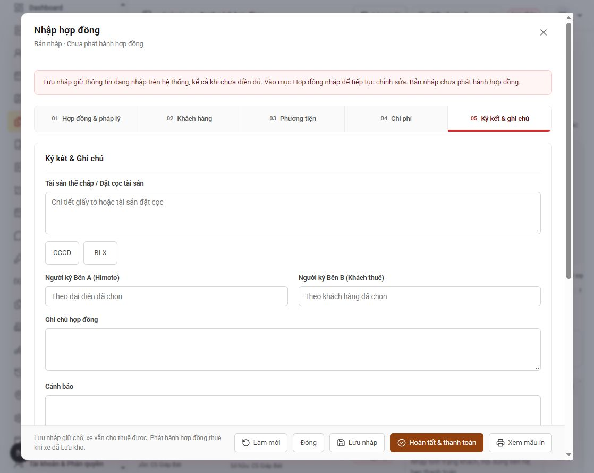

## 4. Lưu và mở lại bản nháp

1. Trong biểu mẫu, bấm **Lưu nháp**.
2. Chờ thông báo lưu thành công.
3. Mở **Hợp đồng nháp** trong menu.
4. Tìm bản nháp theo mã hoặc khách; chọn tiếp tục sửa.
5. Kiểm tra lại thời gian, tình trạng xe và số tiền trước khi hoàn tất.

Bản nháp chưa phải hợp đồng đã phát hành và không tự giữ xe độc quyền. Khi cần giữ xe cho khách, sử dụng nghiệp vụ **Nhận cọc giữ xe**.

## 5. Duyệt hợp đồng

1. Người có quyền duyệt mở danh sách hoặc chi tiết hợp đồng thuộc diện cần duyệt.
2. Chọn **Duyệt hợp đồng** nếu trạng thái đang chờ duyệt.
3. Đối chiếu khách, xe, tiền và hồ sơ.
4. Bấm xác nhận duyệt.
5. Chờ thông báo thành công và làm mới danh sách khi cần.

**Kết quả cần thấy:** nhãn **Đã duyệt** và nút duyệt được ẩn. Người duyệt và thời điểm duyệt được lưu. Không tự coi hợp đồng là đã duyệt chỉ vì đang ở trạng thái Đang thuê.

## 6. Nhận cọc giữ xe

1. Vào **Danh sách hợp đồng → Nhận cọc giữ xe**.
2. Chọn khách, xe và thời gian dự kiến nhận/trả.
3. Nhập tiền giữ xe thực tế nhận và chứng từ tương ứng.
4. Kiểm tra thông tin rồi hoàn tất bước nhận cọc.
5. Khi khách đến nhận xe, mở hợp đồng ở trạng thái **Đặt cọc** và thực hiện bước giao xe theo quyền.

Tiền giữ xe được trừ vào tiền thuê. Không nhầm khoản trả trước này với tiền cọc bảo đảm trong hợp đồng thuê thông thường.

### Tiền giữ xe: ghi số tiền thực tế đã nhận

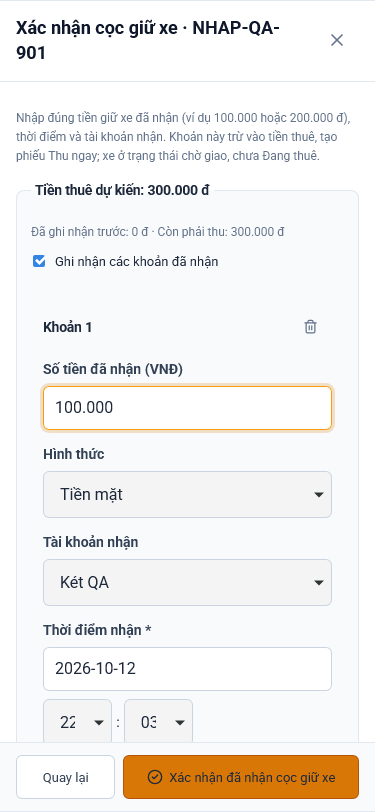

Ảnh minh họa khoản giữ xe 100.000 đồng bằng tiền mặt. Chọn đúng tài khoản/két và thời điểm nhận, lưu bill trước khi xác nhận. Khoản này được trừ vào tiền thuê, không phải cọc bảo đảm.

### Khách đến: tiếp tục giao xe

1. Mở tab Đặt cọc, chọn đúng hợp đồng rồi bấm Giao xe.
2. Bổ sung đủ hồ sơ, ảnh xe và hợp đồng ký.
3. Đối chiếu tiền thuê, khoản đã trả trước và tiền thuê còn lại; khoản trả trước không thu lại lần nữa.
4. Xác nhận giao xe, chờ thành công và kiểm tra trạng thái Đang thuê.

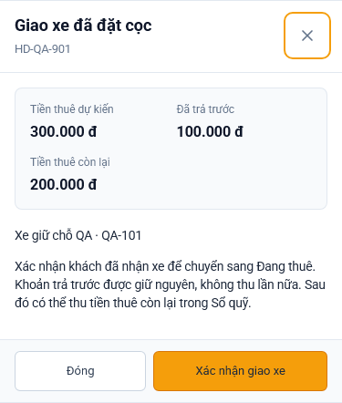

Ảnh minh họa: tiền thuê 300.000 đồng, đã trả trước 100.000 đồng, còn lại 200.000 đồng. Kiểm tra số tiền thực tế của hợp đồng trước khi xác nhận.

## 7. Gia hạn và thu tiền

### Gia hạn thuê thông thường

1. Tìm đúng hợp đồng đang thuê; mở **Thao tác → Gia hạn**.
2. Chọn xe/kỳ cần gia hạn và nhập hạn trả mới.
3. Kiểm tra thời gian, phí gia hạn và số tiền thực nhận.
4. Chọn hình thức thu, tài khoản/két nhận và thời điểm thực tế.
5. Lưu, kiểm tra hạn trả mới và công nợ còn lại.
6. Kiểm tra nội dung Telegram của lần gia hạn rồi gửi.

Tiền gia hạn ghi nhận cho **Công ty**, không phân cho nhân viên/phòng ban. Cơ sở vẫn được ghi nhận phần doanh thu thuê xe tương ứng.

### Thu tiền và đối chiếu công nợ

1. Mở chức năng thanh toán/thu công nợ của đúng hợp đồng nếu có quyền tài chính.
2. Kiểm tra khoản phải thu, đã thu và còn thiếu.
3. Nhập số thực nhận và đúng mục đích thu; không thu cọc thành tiền thuê hoặc ngược lại.
4. Đối chiếu tài khoản/két và chứng từ trước khi xác nhận.
5. Kiểm tra phiếu và số còn thiếu sau khi lưu.

Nếu mất mạng hoặc chưa có kết quả rõ ràng, tải lại trạng thái giao dịch trước khi tạo một lượt thu mới.

### Hợp đồng thuê sở hữu

1. Chọn đúng loại thuê sở hữu và thời hạn tương ứng khi lập hợp đồng.
2. Kiểm tra lịch đóng tiền theo kỳ.
3. Dùng mục **Đến hạn đóng tiền** để theo dõi các khoản đến hẹn.
4. Thu khoản đến hạn theo công nợ/lịch đã lưu; không dùng gia hạn thuê thường để tự cộng thêm kỳ thuê sở hữu.

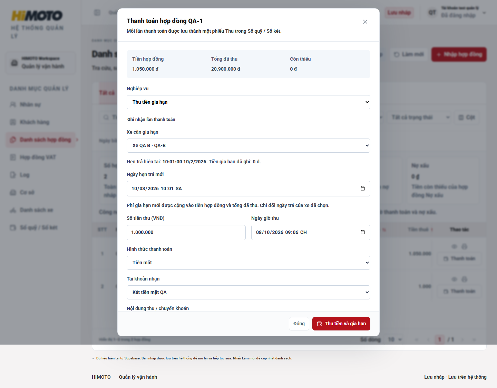

Ảnh minh họa màn hình thanh toán hợp đồng với nghiệp vụ Thu tiền gia hạn; số liệu và tài khoản chỉ là dữ liệu kiểm thử.

### Sửa kỳ gia hạn đã lưu

1. Vào Gửi Telegram, chọn đúng kỳ Gia hạn rồi bấm **Sửa thời gian, phí / thanh toán** nếu có quyền.
2. Chọn đúng phiếu thu, sửa thông tin cần thiết và ghi lý do; kiểm tra hạn mới, số tiền và tài khoản nhận.
3. Lưu và chờ xác nhận; làm mới nội dung và ảnh, kiểm tra bản xem trước trước khi gửi. Nếu chưa rõ kết quả lưu, làm mới để kiểm tra trước khi thử lại.

## 8. Trả xe, đặc biệt hợp đồng nhiều xe

1. Tìm hợp đồng hoặc vào thao tác trả xe.
2. Kiểm tra danh sách biển số trong hợp đồng.
3. **Chỉ tích xe khách thực tế trả.** Hợp đồng nhiều xe không tự tích toàn bộ.
4. Nhập đúng ngày giờ khách trả thực tế.
5. Kiểm tra phí trả muộn, sửa chữa và các điều chỉnh được phép; bổ sung ảnh/video tình trạng trả xe.
6. Đối chiếu công nợ, tiền cọc và khoản cần thu/hoàn theo quyền.
7. Xác nhận trả xe, kiểm tra kết quả và gửi Telegram ở bước cuối.

**Ví dụ:** một hợp đồng có xe A và B; khách chỉ trả A → chỉ chọn A. Lượt thuê của A được đóng, B tiếp tục thuê. Tổng doanh số không tự bị trừ vì đã trả một xe. Chỉ các khoản điều chỉnh/hoàn tiền được nhập và xác nhận riêng mới làm thay đổi phần tiền tương ứng.

Trả hết xe chưa đồng nghĩa đã tất toán tiền: hợp đồng còn khoản phải thu có thể chuyển sang **Chờ tất toán**.

## 9. Sửa hợp đồng và gửi lại Telegram

1. Tìm hợp đồng, mở **Thao tác → Sửa hợp đồng**.
2. Kiểm tra mã hợp đồng đang sửa trước khi đổi thông tin.
3. Sửa nội dung và lưu; nếu sửa tiền/ngày thuê, dùng phần chỉnh sửa phù hợp trong biểu mẫu.
4. Sau khi lưu sửa, bước **Gửi Telegram** được mở.
5. Kiểm tra bản xem trước: nội dung mới nhất, mã HĐ và dòng **SỬA LẠI HỢP ĐỒNG**.
6. Kiểm tra ảnh/video, đúng giao dịch và nơi nhận. Nếu vừa bổ sung ảnh, bấm **Làm mới nội dung và ảnh**.
7. Bấm **Gửi toàn bộ Telegram**.
8. Nếu có tin cũ đủ điều kiện trong 24 giờ, hệ thống yêu cầu thu hồi trước. Chờ thu hồi hoàn tất, kiểm tra lại rồi bấm gửi bản mới.
9. Chờ trạng thái Telegram xác nhận gửi đủ. Không coi trạng thái đang gửi là đã hoàn tất.

### Khi cần chủ động thu hồi một lần gửi

1. Mở phần Telegram của hợp đồng.
2. Mở **Thu hồi tin Telegram**.
3. Chọn đúng lần gửi; xem lại nội dung cũ.
4. Ghi lý do, tích xác nhận và bấm xác nhận thu hồi.
5. Chờ kết quả rồi gửi bản đúng nếu cần.

Tin quá 24 giờ hoặc thiếu thông tin nhóm/mã tin có thể không thu hồi được bằng hệ thống; đối chiếu với quản trị nhóm. Nếu gửi thất bại, mất phản hồi hoặc mới gửi một phần, đọc trạng thái và dùng thao tác xử lý tương ứng, tránh tạo nhiều lượt gửi mới.

## 10. Đọc báo cáo doanh số

1. Mở **Báo cáo doanh thu** hoặc **Dashboard**.
2. Chọn đúng cơ sở và khoảng ngày.
3. Phân biệt **Doanh số** theo giá trị tiền thuê với **Doanh thu thực thu** theo phiếu tiền.
4. Đọc phạm vi ghi ngay tại mỗi báo cáo; báo cáo theo ngày bắt đầu hợp đồng và theo ngày nhận tiền có thể khác nhau.
5. Đối chiếu mục **Phí khác · Công ty** và Sổ quỹ khi cần giải thích chênh lệch.

| Khoản | Nhân viên | Cơ sở | Công ty |
| --- | --- | --- | --- |
| Tiền thuê ban đầu của HĐ đầu tiên | PKD theo phân công/quy tắc ghi nhận | Ghi nhận tiền thuê | Theo dõi tổng |
| Tiền gia hạn | Không ghi nhận cho cá nhân/phòng ban | Vẫn ghi nhận doanh thu thuê xe | Ghi nhận tiền gia hạn |
| VAT, sửa xe, trả muộn và phí khác | Không tính doanh số | Không tính doanh số thuê xe | Theo dõi riêng |
| Tiền cọc bảo đảm | Không tính doanh số thuê xe | Theo dõi tiền cọc riêng | Theo dõi thu/hoàn cọc |

Không lấy **Tổng cần thu gồm cọc** làm doanh số nhân viên. Việc trả xe không tự xóa doanh số đã ghi nhận.

## 11. Xóa, ẩn hợp đồng và phân quyền

### Ai được xóa?

Chỉ **Admin** hoặc **kế toán được cấp quyền Xóa / ẩn hợp đồng**. Các vai trò khác không được cấp quyền này.

### Cấp hoặc gỡ quyền — dành cho Admin

1. Mở **Tài khoản & Phân quyền**.
2. Chọn tài khoản kế toán cần cập nhật.
3. Trong nhóm quyền **Hợp đồng**, tích hoặc bỏ **Xóa / ẩn hợp đồng (Admin, kế toán)**.
4. Lưu, kiểm tra lại tài khoản và phạm vi cơ sở đã cấp.

### Xóa bản nháp

1. Mở **Hợp đồng nháp**; kiểm tra đúng bản nháp chưa phát hành.
2. Chọn **Xóa hẳn bản nháp**.
3. Đọc thông báo rồi xác nhận nếu đúng.

Bản nháp sạch được xóa hẳn. Bản đã có phiếu tiền hoặc lịch sử xe bị chặn để đối chiếu. Nhật ký xóa vẫn lưu riêng người thao tác và ngày giờ.

### Ẩn hợp đồng đã hoàn thành

1. Lọc **Hoàn thành** và chọn đúng hợp đồng.
2. Mở **Thao tác → Ẩn hợp đồng**.
3. Đọc thông báo rồi xác nhận.

Hợp đồng được ẩn khỏi danh sách; dữ liệu gốc, lịch sử xe và phiếu thu/chi vẫn được giữ. Hệ thống ghi người thao tác, ngày giờ và hình thức xóa/ẩn. Nếu cần tra cứu hồ sơ đã ẩn, liên hệ Admin để đối chiếu nhật ký.

## 12. Các thao tác quản lý khác

| Nhu cầu | Vào mục | Cách làm |
| --- | --- | --- |
| Xem trạng thái xe | Danh sách xe | Chọn cơ sở, tìm biển số, kiểm tra xe đang thuê/lưu kho và hợp đồng liên quan |
| Xem luân chuyển | Lịch sử luân chuyển | Tìm xe, đối chiếu cơ sở gửi/nhận và trạng thái xử lý |
| Theo dõi GPS | Định vị GPS | Tìm xe, xem lần cập nhật gần nhất; không nhầm thiếu tín hiệu với đã trả xe |
| Xem hồ sơ khách | Khách hàng | Tìm tên/SĐT/CCCD, đối chiếu cơ sở, cảnh báo và hợp đồng |
| Đối chiếu tiền | Sổ quỹ / Sổ két | Chọn ngày, cơ sở, loại phiếu; đối chiếu mã HĐ và tài khoản nhận/chi |
| Phân ca | Lịch trực cơ sở | Chọn tuần, cơ sở, nhân viên và mã ca; kiểm tra giờ trước khi lưu |
| Ghi nhận ca | Chấm công | Chụp ảnh, lấy GPS và xác nhận vào/ra ca; đối chiếu lịch sử |

## 13. Xử lý tình huống thường gặp

| Hiện tượng | Kiểm tra và xử lý |
| --- | --- |
| Không thấy nút nghiệp vụ | Kiểm tra trạng thái hợp đồng và quyền tài khoản; liên hệ Admin nếu thiếu quyền |
| Ô khách hàng bị khóa | Tra cứu chọn khách hoặc tạo khách mới trước |
| Không quét được căn cước | Chụp rõ mã QR, đủ sáng; nhập tay nếu vẫn không đọc được |
| Không thấy NVKD | Gõ đầy đủ họ tên; kiểm tra nhân sự đang làm việc và chức danh. PKD không phụ thuộc cơ sở nguồn |
| Không thấy hợp đồng | Bỏ bộ lọc ngày/trạng thái/cơ sở, kiểm tra cả Hợp đồng nháp |
| Danh sách chưa cập nhật | Bấm Làm mới dữ liệu hoặc tải lại trang |
| Đã duyệt nhưng vẫn hiện nút | Làm mới danh sách; đối chiếu trạng thái duyệt trong chi tiết |
| Lưu báo phiên bản đã thay đổi | Mở lại dữ liệu mới nhất, kiểm tra thay đổi trước khi lưu lại |
| Telegram chưa ra bản mới | Lưu sửa trước, mở đúng hợp đồng/giao dịch rồi Làm mới nội dung và ảnh |
| Telegram đang thu hồi | Chờ kết quả; sau khi thu hồi xong mới gửi bản đúng |
| Báo cáo khác số tổng trên HĐ | Đối chiếu tiền cọc, VAT/phí khác, khoảng ngày và tiền thực nhận |

## 14. Danh sách kiểm tra cuối giao dịch

- [ ] Đúng khách và số giấy tờ.
- [ ] Đúng mã HĐ giấy, giữ nguyên số 0 đầu.
- [ ] Đúng cơ sở nguồn/doanh thu, cơ sở có xe và người làm hợp đồng.
- [ ] Đúng từng biển số, ngày giờ thuê/trả.
- [ ] Tách rõ tiền thuê, tiền cọc và phí khác.
- [ ] Tiền thực nhận/hoàn khớp chứng từ và tài khoản/két.
- [ ] Ảnh/video được lưu đủ, đúng giao dịch.
- [ ] Hệ thống xác nhận lưu thành công.
- [ ] Đã kiểm tra và gửi Telegram; trạng thái gửi đã rõ ràng.
- [ ] Khi trả một phần, các xe chưa trả vẫn còn đang thuê.

## 15. Phân ca và mã ca chấm công

Chọn mã ca, nhân viên và cơ sở để đối chiếu chấm công.

### Mở lịch trực đúng tuần và cơ sở

**Mở tại:** Lịch trực cơ sở

1. Chọn ngày trong tuần cần phân ca.
2. Chọn cơ sở và nhân viên cần xem.
3. Kiểm tra lịch hiện có trước khi thêm để tránh trùng giờ.

**Kết quả cần thấy:** Đúng tuần, cơ sở và nhân viên.

### Đối chiếu mã ca và công quy định

**Mở tại:** Lịch trực cơ sở → Cài đặt ca chấm công

1. Mở bảng mã ca để kiểm tra giờ bắt đầu, kết thúc và mức công.
2. Chọn mã phù hợp với lịch làm việc thực tế.
3. Mã O là nghỉ, hiện chưa hỗ trợ phân lịch nghỉ.

| Ký hiệu | Chú thích | Giờ làm | Tính công |
| --- | --- | --- | --- |
| S | Ca sáng | 08:00 – 17:00 | 1 |
| G1 | Ca sáng | 08:00 – 12:00 | 0,5 |
| G2 | Ca chiều | 13:00 – 17:00 | 0,5 |
| G3 | Ca tối | 17:00 – 21:00 | 0,5 |
| F | Ca cả ngày | 08:00 – 21:00 | 1,5 |
| O | Nghỉ | — | 0 |
| C | Ca chiều | 13:00 – 21:00 | 1 |

**Kết quả cần thấy:** Mã ca khớp giờ làm và mức công quy định.

**Lưu ý:** Công quy định dùng để đối chiếu; chưa phải công thực tế đã duyệt.

### Phân ca và kiểm tra lịch đã lưu

**Mở tại:** Lịch trực cơ sở → Thêm ca trực

1. Chọn cơ sở và nhân viên đang hoạt động.
2. Chọn Ca chấm công để tự điền giờ; kiểm tra lại ngày bắt đầu và kết thúc.
3. Giữ tên ca là mã đã chọn, kiểm tra vai trò và ghi chú rồi bấm Lưu ca trực.

**Kết quả cần thấy:** Ca xuất hiện đúng ngày, đúng giờ trên lịch.

**Lưu ý:** Sửa giờ riêng thì kiểm tra lại mã ca. Ca qua đêm phải chọn ngày kết thúc kế tiếp. Nếu báo xung đột hoặc chưa rõ kết quả lưu, làm mới lịch để kiểm tra trước khi thêm lại.

## 16. Chấm công vào và ra ca

Chụp ảnh, lấy GPS và ghi nhận giờ vào/ra theo giờ Việt Nam.

### Cài đặt tọa độ chấm công cho cơ sở

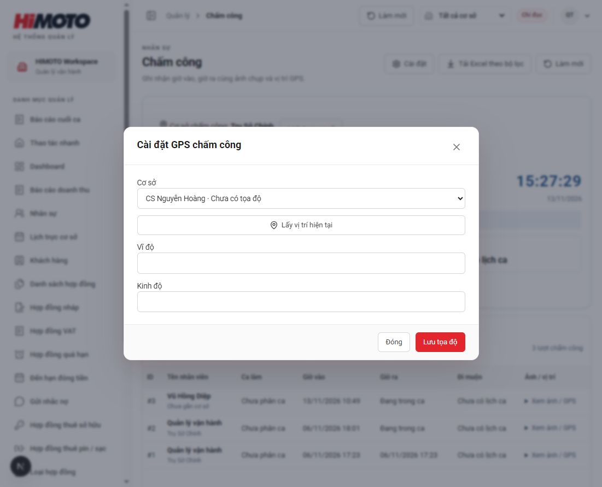

**Mở tại:** Chấm công → Cài đặt

1. Người được cấp quyền chỉnh sửa chọn đúng cơ sở.
2. Đứng tại cơ sở rồi bấm Lấy vị trí hiện tại và cho phép truy cập vị trí; hoặc nhập Vĩ độ, Kinh độ đã kiểm tra.
3. Bấm Lưu tọa độ và chờ thông báo Đã lưu tọa độ chấm công.

**Kết quả cần thấy:** Mở lại cơ sở và kiểm tra tọa độ đã lưu.

**Lưu ý:** Nếu chỉ có quyền xem, liên hệ người quản lý được cấp quyền để cập nhật. Không lấy vị trí hiện tại khi đang ở nơi khác.

### Kiểm tra tài khoản và lịch làm việc

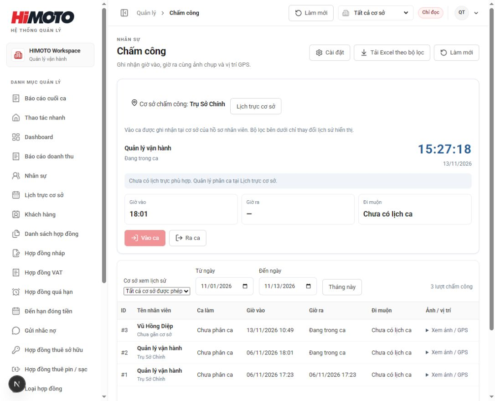

**Mở tại:** Chấm công

1. Đăng nhập tài khoản cá nhân đã liên kết hồ sơ nhân viên đang hoạt động.
2. Kiểm tra tên nhân viên, lịch ca và giờ hiển thị.
3. Nếu chưa có lịch ca phù hợp, báo quản lý kiểm tra Lịch trực cơ sở.

**Kết quả cần thấy:** Đúng nhân viên và lịch ca cần làm.

**Lưu ý:** Nhân viên xem lịch sử của mình; người có quyền nhân sự xem theo phạm vi cơ sở.

### Chụp ảnh và xác nhận vào ca

**Mở tại:** Chấm công → Vào ca

1. Cho phép camera và vị trí trên thiết bị.
2. Bấm Chụp ảnh, kiểm tra ảnh xem trước; dùng Chụp lại nếu ảnh chưa rõ.
3. Bấm Xác nhận vào ca; hệ thống lấy GPS mới rồi lưu. Chờ thành công và kiểm tra Giờ vào.

**Kết quả cần thấy:** Hiển thị Đang trong ca và có giờ vào.

**Lưu ý:** Mở bằng HTTPS hoặc localhost và bật quyền camera, vị trí. Khi lỗi GPS, kiểm tra quyền và bật định vị rồi xác nhận lại. Chưa rõ kết quả lưu thì làm mới để kiểm tra; không bấm gửi liên tục.

### Xác nhận ra ca bằng ảnh và GPS mới

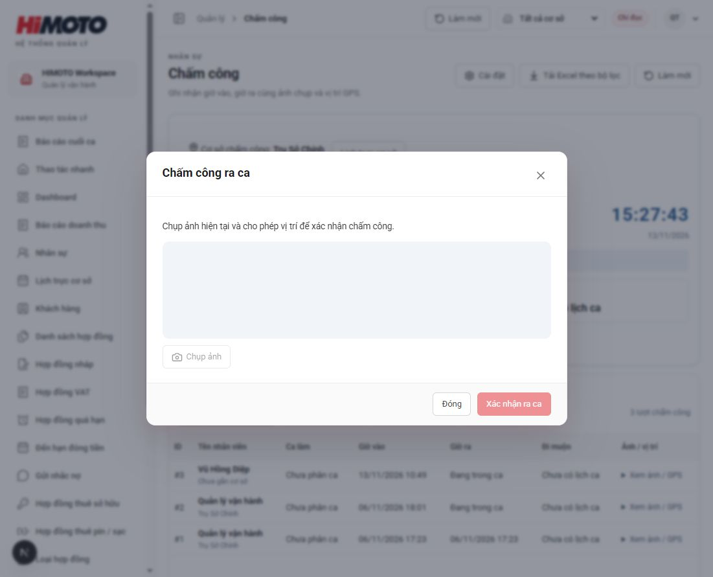

**Mở tại:** Chấm công → Ra ca

1. Bấm Ra ca, chụp ảnh hiện tại và kiểm tra ảnh xem trước.
2. Bấm Xác nhận ra ca; hệ thống tự lấy GPS mới. Chờ thông báo lưu thành công.
3. Kiểm tra Giờ ra và dòng lịch sử của ca vừa kết thúc.

**Kết quả cần thấy:** Có đủ giờ vào và giờ ra; ca đã kết thúc.

**Lưu ý:** Phải ra ca trước khi bắt đầu ca mới. Giờ ghi nhận theo máy chủ, giờ Việt Nam. Ảnh minh họa hộp thoại khi camera chưa sẵn sàng; cần mở được camera và chụp ảnh để bật nút xác nhận.

### Đối chiếu lịch sử chấm công

**Mở tại:** Chấm công → bộ lọc ngày

1. Chọn Từ ngày, Đến ngày hoặc Tháng này; mỗi khoảng tối đa 93 ngày.
2. Đối chiếu mã ca, giờ dự kiến, giờ vào/ra và số phút đi muộn.
3. Mở ảnh và vị trí để kiểm tra; báo quản lý nếu lịch ca hoặc bằng chứng chưa khớp.

**Kết quả cần thấy:** Lịch sử đúng người, đúng ngày và có bằng chứng.

**Lưu ý:** Công quy định là mức của mã ca, không tự xác nhận công hưởng lương. Nếu chưa phân ca, hệ thống chưa xác định được đi muộn.

## 17. Xử lý Telegram chậm hoặc gửi chưa đủ

Phân biệt ảnh đã lưu, đang gửi, gửi thiếu và mất phản hồi.

### Ảnh đã lưu nhưng chưa gửi Telegram

**Mở tại:** Hợp đồng → Gửi Telegram

1. Chọn đúng giao dịch, đặc biệt đúng kỳ gia hạn.
2. Đọc nội dung, nơi nhận và kiểm tra đủ ảnh/video.
3. Bấm Gửi toàn bộ Telegram một lần rồi chờ trạng thái cập nhật.

**Kết quả cần thấy:** Giao dịch chuyển sang hàng đợi hoặc trạng thái gửi.

**Lưu ý:** Chờ bấm gửi chỉ có nghĩa hồ sơ đã lưu, chưa gửi vào nhóm. Lưu ảnh không tự gửi Telegram.

### Xử lý màn hình phản hồi chậm

**Mở tại:** Gửi Telegram → Làm mới nội dung và ảnh

1. Đợi thao tác đang chạy hoàn tất; xem thông báo lỗi nếu có.
2. Nếu tải quá lâu hoặc mất mạng, kiểm tra kết nối rồi làm mới nội dung và ảnh.
3. Nếu vừa bấm gửi, kiểm tra trạng thái và nhóm nhận trước khi quyết định gửi lại.

**Kết quả cần thấy:** Đã biết giao dịch đang chờ, đã gửi hay cần xử lý tiếp.

**Lưu ý:** Không đóng rồi tạo lại giao dịch chỉ vì phản hồi chậm. Khi báo lỗi cho quản lý, gửi mã HĐ, kỳ giao dịch, thời điểm và ảnh màn hình.

### Tiếp tục phần Telegram chưa nhận

**Mở tại:** Gửi Telegram → Gửi chưa hoàn tất

1. Đối chiếu số tệp Telegram đã nhận với tổng cần gửi.
2. Nếu lần trước timeout hoặc mất mạng, kiểm tra album trong nhóm trước.
3. Dùng Gửi tiếp phần còn thiếu hoặc Gửi tiếp nội dung theo nút hiển thị.

**Kết quả cần thấy:** Telegram xác nhận đủ tệp và nội dung.

**Lưu ý:** Gửi tiếp dùng bộ hồ sơ và nhóm của lần đã lưu. Nếu album mất phản hồi nhưng thực tế đã lên nhóm, có thể trùng một phần khi gửi tiếp.

### Đối chiếu trước khi gửi lại

**Mở tại:** Gửi Telegram → Cần đối chiếu Telegram

1. Tìm đúng mã HĐ và kỳ giao dịch trong nhóm nhận.
2. Chỉ xác nhận chưa có tin khi đã kiểm tra chắc chắn.
3. Nếu có lựa chọn Gửi lại sau khi đối chiếu, dùng sau khi xác nhận; nếu không có, báo quản trị kèm mã HĐ.

**Kết quả cần thấy:** Kết quả gửi đã rõ ràng, tránh gửi trùng.

**Lưu ý:** Đã gửi Telegram: hệ thống khóa gửi lại nội dung không đổi. Muốn sửa hồ sơ, cập nhật dữ liệu rồi làm mới và kiểm tra bản mới.

---

**Ghi chú biên tập:** tài liệu hiện có 8 ảnh giao diện cho quy trình nhập hợp đồng, quét QR, tiền giữ xe và giao xe đã đặt cọc. Các nghiệp vụ sau phát hành có hướng dẫn bằng chữ; có thể bổ sung ảnh từ dữ liệu minh họa được duyệt khi đào tạo. Ảnh đang liên kết từ thư mục `images` lưu cùng tài liệu; xem `QUAN-LY-ANH.md` để chuyển sang Cloudinary.
